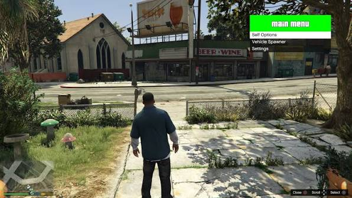
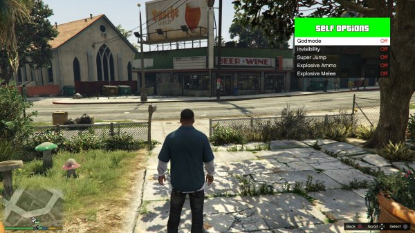
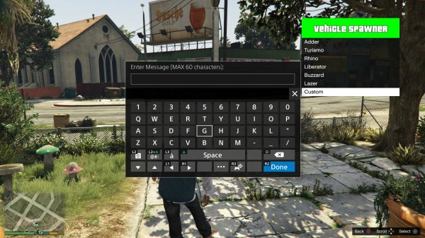
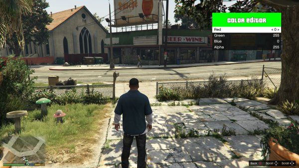

# PS4 GTA V Menu Base (Fork)

A mod menu GUI for PS4 GTA V, forked from
[2much4u/PS4-GTA-V-Menu-Base](https://github.com/2much4u/PS4-GTA-V-Menu-Base).

## Pictures






## Key Features

* Unlimited submenus
* Unlimited options
* Option & submenu remembrance
* Auto adjusting and scrolling background
* Full customization
* Simple keyboard input and handling
* Support for numerous dynamic option types
* Button instructions display
* Example options and vehicle spawner

## Requirements

* A PS4 on a firmware supported by the payload SDK
* [PS4 Payload SDK](https://github.com/themonsterdev/ps4-payload-sdk)
* Docker (recommended) or a native `gcc` toolchain with `PS4SDK` set

## Build

### With Docker (recommended)

This repository includes a `Dockerfile` and a `docker-compose.yml` to build
the payload in a container, regardless of your host OS (Linux, macOS, Windows).

First, build the SDK image once (from the `ps4-payload-sdk` directory):

```bash
docker build -t ps4-sdk-builder .
```

Then, from this repository:

```bash
# Build the payload
docker compose run --rm builder make -C libPS4
docker compose run --rm builder make

# Clean the build directory
docker compose run --rm builder make clean
```

The resulting `*.bin` payload will be placed at the root of the repository.

### Without Docker

If you already have the SDK installed locally (`$PS4SDK` set) and a working
gcc toolchain:

```bash
make
```

## Notes

While the example submenus showcase much of the menu base's functionality, more
is possible. Check out `menu.cpp` for all supported option types.

`Menu::vehicleSpawn` and `Menu::vehicleToSpawn` are only for the example
`vehicleSpawner` submenu and are unnecessary to the overall menu base.

The UI is intentionally simple and can be extended (e.g. adding sprites).

## Differences from upstream

* Added Docker support (`Dockerfile`, `docker-compose.yml`) for reproducible
* builds across platforms.

## Credits

### PS4 research

* Specter, CTurt, qwertyoruiopz, flatz, idc, SKFU, droogie, Xerpi, bigboss, Hunger, Takezo, and Proxima — PS4 research making all this possible.

### GTA V research

* Alexander Blade and [NativeDB contributors](https://nativedb.dotindustries.dev/) — Native research making GTA V stuff relatively easy to port to PS4.

### This project

* Original menu base: [2much4u](https://github.com/2much4u/PS4-GTA-V-Menu-Base)
* Native caller: [2much4u/PS4-GTA-V-Native-Caller](https://github.com/2much4u/PS4-GTA-V-Native-Caller)
* Payload SDK: [themonsterdev/ps4-payload-sdk](https://github.com/themonsterdev/ps4-payload-sdk)

## License

See [LICENSE](LICENSE) for details.
